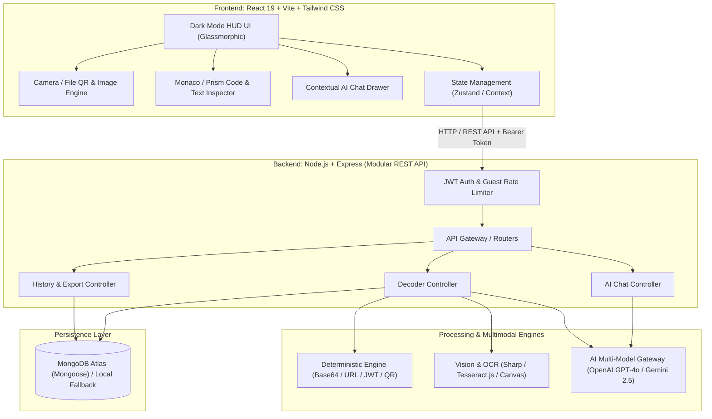

# AI DECODER — Advanced Full-Stack AI-Powered Multimodal Decoder SaaS
### Comprehensive Technical Architecture & Project Blueprint

> [!NOTE]
> **Project Goal**: Build an enterprise-grade, portfolio-ready **All-in-One AI Decoder SaaS** inspired by cybersecurity HUD aesthetics (SentinelX, Linear, Raycast). It decodes, translates, inspects, and analyzes obscure text, programming code, images, QR codes, encoded ciphers (Base64, Hex, Binary, JWT, URL), and provides an interactive AI Chat Assistant for context-aware follow-up inquiries.

---

## 1. System Architecture Overview



---

## 2. Core Functional Modules

| Module | Core Functionality | Engine / Tooling |
| :--- | :--- | :--- |
| **AI Text Decoder** | Detects sentiment, jargon, obfuscated semantics, cryptographic ciphers (Caesar, ROT13, Vigenère), ancient or foreign languages, and outputs simplified "ELI5" summaries and analytical breakdowns. | LLM (GPT-4o-mini / Gemini 2.5) + Heuristic Regex |
| **Code Decoder** | Analyzes syntax, complexity ($O(n)$ time/space), security vulnerabilities (OWASP top 10), bugs, and translates between languages (e.g. Python $\leftrightarrow$ TypeScript $\leftrightarrow$ Rust $\leftrightarrow$ Go). | Syntax AST + Monaco/Prism + Structured Prompting |
| **Image & Vision Decoder** | Analyzes uploaded images: extracts visible text (OCR), detects objects, deciphers diagrams/architectures, and flags sensitive image contents. | Multimodal Vision AI (`gpt-4o` / `gemini-2.5-flash`) + Sharp |
| **QR & Barcode Decoder** | Live camera video stream scan or drag-and-drop image scan; parses WiFi configs, vCards, URLs, cryptographic payloads, and passes content to AI for safety verification. | `html5-qrcode` / `jsqr` + AI Safety Verification |
| **Cipher & Encoding Decoder** | Dual-mode instant deterministic decoding (Base64, Hex, Binary, URL Percent-encoding, Unicode, JWT token payload/header inspection) paired with AI contextual analysis. | Native Node/Browser Buffers + JWT decoder + AI audit |
| **Contextual AI Chat** | Conversational sidecar that automatically inherits the decoded artifact (code, text, image analysis, or QR payload) as active context for follow-up questions. | Stateful Chat Session with contextual system injection |
| **History & Knowledge Vault** | Searchable history with tag filtering, favorites, execution speed telemetry, and 1-click export to Markdown, PDF, or JSON. | MongoDB Collections / Local JSON fallback storage |

---

## 3. Recommended Technology Stack

```mermaid
flowchart LR
    subgraph Frontend
        F1["React 19 (Vite)"]
        F2["Tailwind CSS v3/v4"]
        F3["Lucide-React (Icons)"]
        F4["html5-qrcode (Camera / Upload)"]
        F5["PrismJS (Code Highlighting)"]
        F6["Zustand (State)"]
    end

    subgraph Backend
        B1["Node.js (v20+)"]
        B2["Express.js (REST)"]
        B3["Mongoose (MongoDB ODM)"]
        B4["Multer (Multipart Image Handling)"]
        B5["OpenAI & Google GenAI SDKs"]
        B6["jsonwebtoken & bcryptjs"]
    end

    subgraph Infrastructure
        I1["Vercel (Client Hosting)"]
        I2["Render / Railway (Backend API)"]
        I3["MongoDB Atlas (Cloud Database)"]
    end

    Frontend --> Backend
    Backend --> Infrastructure
```



- **Frontend**: React 19 + Vite (for sub-second HMR and instant builds), Tailwind CSS (for SentinelX cyber-dark UI aesthetic), Lucide React, PrismJS, `html5-qrcode`.
- **Backend**: Node.js + Express.js, Multer (in-memory image buffer handling), `cors`, `helmet`, `express-rate-limit`.
- **AI Integration**: Dual-adapter pattern supporting both **OpenAI API** (`gpt-4o`, `gpt-4o-mini`) and **Google Gemini API** (`gemini-2.5-flash`) with automatic fallback.
- **Database**: MongoDB with Mongoose. Includes a resilient built-in JSON file store / mock adapter so the system boots immediately with zero external dependencies when local MongoDB is not yet provisioned.

---

## 4. Database Schema (Mongoose Models)

### User Schema (`models/User.js`)
```javascript
import mongoose from 'mongoose';

const userSchema = new mongoose.Schema({
  name: { type: String, required: true },
  email: { type: String, required: true, unique: true, index: true },
  password: { type: String, required: true },
  role: { type: String, enum: ['user', 'pro', 'admin'], default: 'user' },
  usageCount: { type: Number, default: 0 },
  createdAt: { type: Date, default: Date.now }
});
```

### Decode Record Schema (`models/DecodeRecord.js`)
```javascript
import mongoose from 'mongoose';

const decodeRecordSchema = new mongoose.Schema({
  userId: { type: mongoose.Schema.Types.ObjectId, ref: 'User', default: null, index: true },
  decoderType: { 
    type: String, 
    required: true, 
    enum: ['text', 'code', 'image', 'qr', 'url', 'base64', 'jwt', 'cipher'] 
  },
  rawInput: { type: String, required: true },
  decodedOutput: { type: String, required: true },
  aiExplanation: {
    summary: { type: String },
    breakdown: [String],
    securityAudit: { type: String },
    complexity: { type: String },
    detectedFormat: { type: String }
  },
  metadata: {
    language: String,
    executionTimeMs: Number,
    tokensUsed: Number,
    isBookmarked: { type: Boolean, default: false }
  },
  createdAt: { type: Date, default: Date.now, index: true }
});
```

### Chat Conversation Schema (`models/ChatMessage.js`)
```javascript
import mongoose from 'mongoose';

const chatMessageSchema = new mongoose.Schema({
  userId: { type: mongoose.Schema.Types.ObjectId, ref: 'User', default: null },
  decodeId: { type: mongoose.Schema.Types.ObjectId, ref: 'DecodeRecord', required: true, index: true },
  role: { type: String, enum: ['user', 'assistant', 'system'], required: true },
  content: { type: String, required: true },
  timestamp: { type: Date, default: Date.now }
});
```

---

## 5. REST API Specification

| Endpoint | Method | Auth | Description |
| :--- | :--- | :--- | :--- |
| `/api/auth/register` | `POST` | Public | Register new user account with hashed password |
| `/api/auth/login` | `POST` | Public | Authenticate user & issue JWT bearer token |
| `/api/auth/me` | `GET` | Required | Retrieve current user profile and quota usage |
| `/api/decode/text` | `POST` | Optional | Analyze & decode obfuscated or complex text |
| `/api/decode/code` | `POST` | Optional | Explain, audit, and translate programming snippets |
| `/api/decode/image` | `POST` | Optional | Multipart upload; multimodal visual & OCR decoding |
| `/api/decode/qr` | `POST` | Optional | Extract QR payload & perform AI security audit |
| `/api/decode/cipher` | `POST` | Optional | Deterministic Base64/Hex/URL/JWT decode + AI breakdown |
| `/api/chat` | `POST` | Optional | Ask follow-up questions linked to a `decodeId` |
| `/api/history` | `GET` | Optional | List past decodes with pagination, search, and type filter |
| `/api/history/:id` | `DELETE` | Optional | Remove a record from history |
| `/api/history/:id/bookmark` | `PATCH` | Optional | Toggle bookmark / favorite status |

---

## 6. Monorepo Project Structure

```text
ai-decoder/
├── client/                     # Frontend Application (React 19 + Vite + Tailwind)
│   ├── public/
│   │   └── favicon.svg
│   ├── src/
│   │   ├── assets/
│   │   ├── components/
│   │   │   ├── common/         # Button, Modal, Tabs, Badge, Toast
│   │   │   ├── decoders/       # TextDecoder, CodeDecoder, ImageDecoder, QRDecoder, CipherDecoder
│   │   │   ├── chat/           # ChatSidecar, MessageBubble, ChatInput
│   │   │   ├── history/        # HistoryTable, HistoryCard, ExportButton
│   │   │   └── layout/         # Navbar, Sidebar, HUDHeader, Footer
│   │   ├── context/            # AuthContext, ToastContext
│   │   ├── hooks/              # useDecoder, useCameraQR, useHistory
│   │   ├── services/           # api.js (Axios / Fetch client)
│   │   ├── utils/              # formatters.js, ciphers.js, qrHelpers.js
│   │   ├── App.jsx
│   │   ├── index.css           # Tailwind custom HUD scanline & glowing neon effects
│   │   └── main.jsx
│   ├── index.html
│   ├── tailwind.config.js
│   ├── vite.config.js
│   └── package.json
│
├── server/                     # Backend Application (Node.js + Express)
│   ├── src/
│   │   ├── config/             # db.js, aiConfig.js
│   │   ├── controllers/        # authController.js, decodeController.js, chatController.js, historyController.js
│   │   ├── middleware/         # authMiddleware.js, rateLimiter.js, uploadMiddleware.js
│   │   ├── models/             # User.js, DecodeRecord.js, ChatMessage.js, LocalStore.js
│   │   ├── routes/             # authRoutes.js, decodeRoutes.js, chatRoutes.js, historyRoutes.js
│   │   ├── services/           # aiService.js (OpenAI + Gemini adapter), ocrService.js, deterministicService.js
│   │   ├── utils/              # cipherAlgorithms.js, promptTemplates.js
│   │   └── server.js           # Express main server entry point
│   ├── .env.example
│   └── package.json
│
├── .gitignore
├── README.md
└── package.json                # Root concurrent runner (`npm run dev`)
```

---

## 7. Step-by-Step Implementation Roadmap

1. **Step 1: Scaffolding & Root Configuration**
   - Initialize monorepo root with concurrent scripts (`npm run dev:client`, `npm run dev:server`, `npm run dev:all`).
   - Create client Vite app and server Express project.

2. **Step 2: Server API & Multi-Provider AI Engine**
   - Configure Express with security headers, CORS, and JSON parser.
   - Build `aiService.js` supporting both OpenAI API and Google Gemini API (reading `OPENAI_API_KEY` or `GEMINI_API_KEY`).
   - Implement deterministic decoders for Base64, Hex, Binary, URL, and JWT token inspection.
   - Implement routes: `/api/decode/*`, `/api/chat`, `/api/history`.
   - Setup Mongoose with automatic fallback to JSON file storage for zero-friction local development.

3. **Step 3: Cyberpunk / HUD Theme & Component Library**
   - Configure Tailwind CSS with obsidian black (`#0B0F19`), neon cyan (`#00F0FF`), glowing violet (`#8B5CF6`), and cyber emerald (`#10B981`).
   - Build responsive layout with Sidebar, HUD Status Bar, and Tab Switcher.

4. **Step 4: Specialized Decoders**
   - **Text & Cipher Tab**: Dual-pane input/output with deterministic and AI analysis tabs.
   - **Code Explainer Tab**: Monaco/Prism syntax highlighter, language selector, bug finder, and complexity meter.
   - **QR & Barcode Tab**: Live webcam scanner (`html5-qrcode`) and file upload scanner with instant security verification.
   - **Image Decoder Tab**: Drag-and-drop vision analysis with OCR and object detection.

5. **Step 5: Contextual Follow-Up Chat & History Vault**
   - Slide-over AI Chat drawer that maintains context of the active decoded item.
   - History viewer with search, filtering by decoder category, and JSON/Markdown export.

6. **Step 6: Polish, Testing & Deployment**
   - Health check endpoints, sample test payloads, environment variable validation, and deployment instructions for Vercel and Render.
