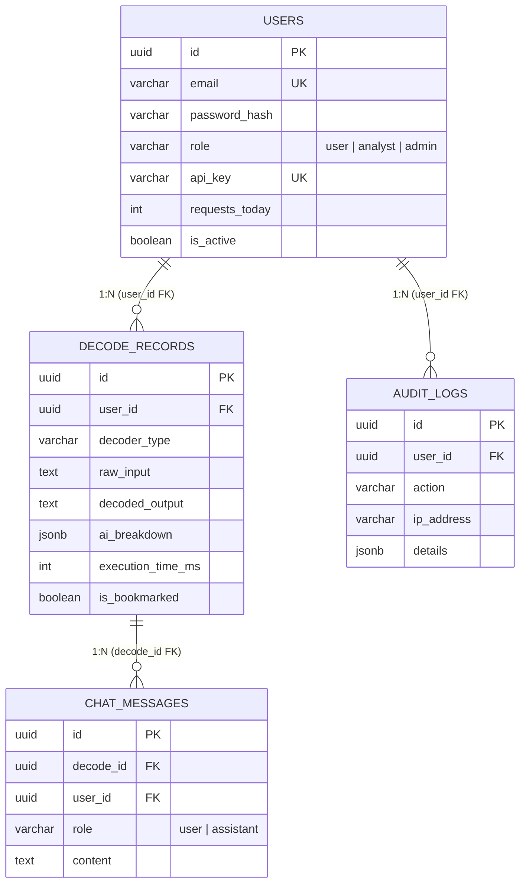

# ⚡ AI DECODER — Advanced Full-Stack AI-Powered Multimodal Decoder SaaS

[](https://react.dev/)
[](https://tailwindcss.com/)
[](https://nodejs.org/)
[](https://expressjs.com/)
[](https://www.postgresql.org/)
[](https://www.mongodb.com/)
[](https://www.docker.com/)
[](http://localhost:5000/api/docs)
[](https://openai.com/)

> **AI DECODER** is an enterprise-grade multimodal cybersecurity intelligence, reverse-engineering, and decryption SaaS platform inspired by SentinelX and modern dark cybernetic HUD aesthetics. It unifies zero-latency deterministic decoding with advanced generative AI reasoning to understand, translate, audit, and decompose obscure text, source code, optical media (QR/Barcodes), raster images, cryptographic ciphers, and production prompt templates.

---

## 🚀 Key Functional Modules

| # | Module | Core Functionality | Engine / Technologies |
| :-: | :--- | :--- | :--- |
| **1** | **AI Text & Semantic Decoder** | Deciphers obfuscated strings, foreign languages, dense legal/technical jargon, and classic ciphers into plain, actionable language with 4 selectable depths (Analytical, ELI5, Threat, Linguistic). | LLM Prompt Firewall + Heuristic Regex |
| **2** | **Code & AST Vulnerability Decoder** | Multi-language AST inspection (JS, TS, Python, Rust, Go, C++, SQL). Computes Big-O time and space complexity ($O(N)$, $O(1)$) and cross-references with **CWE** and **OWASP Top 10** taxonomies. | AST Tokenizer + Structured AI Audit |
| **3** | **Cipher & Encoding Laboratory** | Sub-millisecond deterministic transformations + semantic auditing for **Base64** (including recursive nested layers), **JWT** (Header, Payload, Expiry countdown), **Hex**, **Binary**, **URL**, **ROT13**, **Atbash**, and **Morse Code**. | Native Buffers + Deterministic Engine |
| **4** | **QR & Barcode Security Inspector** | Tri-mode scanning (Live camera stream via `html5-qrcode`, drag-and-drop QR image upload, and raw string payload) with automated phishing and malicious redirect detection. | `html5-qrcode` + Vision AI Safety Scanner |
| **5** | **Multimodal Vision & OCR Decoder** | Ingests raster image formats (PNG, JPG, WEBP) to extract visible text via OCR and decomposes complex cloud architectures and system diagrams. | Gemini 2.5 Flash / GPT-4o Vision + Canvas |
| **6** | **AI Prompt Engineering & Optimizer** | Audits prompt templates across 4 dimensions (Clarity, Constraints, Output Structure, Token Efficiency), flags anti-patterns, and generates 3 hardened production variations (Standard XML, Chain-of-Thought, Deterministic Schema). | Prompt Engineering Engine + Health Radar |
| **7** | **Contextual AI Copilot Chat** | Slide-over conversational assistant automatically linked to the active decoded artifact. Ask: *"Is this payload safe?"*, *"How do I patch this in production?"*, *"Convert to TypeScript"*. | Stateful Sidecar + Active Context Grounding |
| **8** | **History Vault & Export Engine** | Searchable archive with category filtering, Starred/Bookmark tagging, and 1-click export to **Markdown (`.md`)** or **JSON (`.json`)**. | PostgreSQL / MongoDB / Local JSON Store |

---

## 🏛️ Full-Stack Architecture & Web Dev Roadmap 2026 Alignment

The architecture of **AI DECODER** answers the **3 core questions** from the **Web Development Roadmap 2026**:

```mermaid
flowchart TD
    subgraph Q1 ["🧠 1. How Does the Logic Work?"]
        L1["HTTP Request-Response Cycle"] --> L2["Security: Helmet + Rate Limiters"]
        L2 --> L3["Identity & RBAC: Bearer JWT + X-API-Key"]
        L3 --> L4["Dual-Engine Dispatch: Deterministic (0ms) vs AI Gateway"]
        L4 --> L5["HUD Telemetry Logger & Structured Output"]
    end

    subgraph Q2 ["🗄️ 2. Where is Data Stored?"]
        D1["PostgreSQL Relational Schema (UUID PK, FK, Constraints)"]
        D2["1:N Relationships (Users -> Decodes -> Chat Messages)"]
        D3["SQL Joins for Analytics & Aggregation"]
        D1 --> D2 --> D3
    end

    subgraph Q3 ["👥 3. How Do Roles Work? (RBAC)"]
        R1["Database Role Column: user | analyst | admin"]
        R2["Cryptographically Signed JWT Claims + X-API-Key"]
        R3["Middleware Permission Guards: requireRole(['admin'])"]
        R4["Conditional UI Views & Admin Telemetry Dashboard"]
        R1 --> R2 --> R3 --> R4
    end
```



---

### Question 1: How Does the Logic Work?
*(Fundamentals of Backend: Request-Response Cycle, APIs, Routes, Middleware, Error Handling)*

In **AI DECODER**, business logic executes through an authenticated 6-stage pipeline:

```text
[Client Request]
       │
       ▼
1. Security & Hygiene Gateway (helmet() HTTP headers, cors(), JSON parser)
       │
       ▼
2. Rate Limiting Middleware (express-rate-limit prevents DoS / Brute-Force)
       │
       ▼
3. Identity & Role Resolution (Resolves Bearer JWT or X-API-Key into req.user)
       │
       ▼
4. Dual-Engine Dispatch (Controllers):
   ├── Deterministic Engine: Base64, Hex, Binary, JWT, ROT13, Morse (0ms local execution)
   └── AI Neural Gateway: Gemini 2.5 Flash / OpenAI GPT-4o / Heuristic Simulator
       │
       ▼
5. Persistence & Telemetry (Writes to PostgreSQL / MongoDB / LocalStore + Logs ms latency)
       │
       ▼
[Structured JSON Response] (Or Global Error Handler on failure)
```

**Code Reference in [`server/src/server.js`](server/src/server.js):**
```javascript
app.use(helmet());
app.use(cors({ origin: '*', allowedHeaders: ['Content-Type', 'Authorization', 'X-API-Key'] }));
app.use(requestLogger);                  // Logs HTTP method, URL, and ms latency
app.use(optionalAuth);                   // Resolves JWT or X-API-Key
app.use('/api/decode', decoderLimiter, decodeRoutes);
app.use('/api/admin', requireAuth, requireRole(['admin']), adminRoutes);
```

---

### Question 2: Where is the Data Stored?
*(Fundamentals of Database: PostgreSQL, Tables, Keys, Relationships & Joins)*

Data is modeled using relational principles in [`server/src/db/schema.sql`](server/src/db/schema.sql) and [`server/src/config/postgres.js`](server/src/config/postgres.js):



#### Relational Concepts Applied:
1. **Primary Keys (PK)**: Cryptographic UUIDs (`uuid_generate_v4()`) prevent sequential enumeration attacks.
2. **Foreign Keys (FK) & Cascades**:
   - `decode_records.user_id REFERENCES users(id) ON DELETE SET NULL`
   - `chat_messages.decode_id REFERENCES decode_records(id) ON DELETE CASCADE` (deleting a record cleans up related chat history).
3. **Compound Indexes**: `CREATE INDEX idx_decode_user_created ON decode_records(user_id, created_at DESC);`
4. **Relational SQL JOIN Query** ([`server/src/config/postgres.js`](server/src/config/postgres.js)):
```sql
SELECT 
  d.id, d.decoder_type, d.decoded_output, d.execution_time_ms,
  u.name AS operator_name, u.email AS operator_email, u.role
FROM decode_records d
LEFT JOIN users u ON d.user_id = u.id
WHERE d.is_bookmarked = TRUE
ORDER BY d.created_at DESC;
```
5. **Multi-Database Resilience**: When PostgreSQL (`DATABASE_URL`) or MongoDB (`MONGODB_URI`) is not provisioned, the built-in [`server/src/models/LocalStore.js`](server/src/models/LocalStore.js) provides 100% feature parity using an embedded JSON document engine.

---

### Question 3: How Do You Provide Different Roles? (RBAC)
*(Authentication & Authorization: Role-Based Access Control)*

Enforced across 3 distinct architectural layers:

1. **Database Layer**:
   ```sql
   role VARCHAR(20) NOT NULL DEFAULT 'user' CHECK (role IN ('user', 'analyst', 'admin'))
   ```
2. **Cryptographic Token (JWT)**:
   ```javascript
   const token = jwt.sign({ id: user.id, email: user.email, role: user.role }, JWT_SECRET, { expiresIn: '7d' });
   ```
3. **Backend Middleware Authorization Guard** ([`server/src/middleware/authMiddleware.js`](server/src/middleware/authMiddleware.js)):
   ```javascript
   export const requireRole = (allowedRoles = []) => (req, res, next) => {
     if (!req.user) return res.status(401).json({ message: 'Authentication required' });
     if (!allowedRoles.includes(req.user.role)) {
       return res.status(403).json({ message: `Forbidden: Requires [${allowedRoles.join(', ')}] permissions.` });
     }
     next();
   };
   ```

#### Permissions Matrix:
| Feature / Endpoint | Standard User | Security Analyst | Chief Admin |
| :--- | :---: | :---: | :---: |
| Run All 7 Decoders (Text, Code, QR, Cipher, Vision, Prompt) | ✅ | ✅ | ✅ |
| Personal History Vault & Export (`.md` / `.json`) | ✅ | ✅ | ✅ |
| Developer API Key Access (`X-API-Key`) | ❌ | ✅ | ✅ |
| Admin Telemetry & Audit Logs (`/api/admin/*`) | ❌ (403 Forbidden) | ❌ (403 Forbidden) | ✅ |

---

## 📦 Quick Start Guide

### 1. Prerequisites
- **Node.js** v18+ (tested on Node v20/v26)
- **npm** v9+
- *(Optional)* Docker & Docker Compose for dedicated MongoDB / PostgreSQL containers.

### 2. Installation
```bash
# Install backend dependencies
cd server
npm install

# Install frontend dependencies
cd ../client
npm install
```

### 3. Database Seeding (Populates Demo Admin, Analyst & Vault)
```bash
npm run db:seed
```
*Pre-configured Demo Accounts:*
- **Admin**: `admin@ai-decoder.io` / `CyberAdmin2026!` (API Key: `aid_admin_master_key_998877`)
- **Analyst**: `analyst@ai-decoder.io` / `AnalystPass2026!` (API Key: `aid_analyst_key_112233`)

### 4. Running the Application

You can start both the backend and frontend simultaneously with a single command from the project root:

```bash
npm run dev
```

Or run them individually in separate terminal sessions:

**Terminal 1 (Backend API):**
```bash
npm run dev:server
# Running on http://localhost:5000
```

**Terminal 2 (Frontend Client):**
```bash
npm run dev:client
# Running on http://localhost:3000
```

Open your browser at **`http://localhost:3000`** to access the dashboard!

---

## 🧪 Automated Backend Test Suite

Run the automated backend test suite covering 10 critical security and functional test vectors:

```bash
npm test
```

**Test Verification Output:**
```text
=======================================================
🧪 RUNNING AI DECODER AUTOMATED BACKEND TEST SUITE
🎯 Target API: http://localhost:5000
=======================================================
  ✅ PASS: Health check endpoint (/api/health) (103ms)
  ✅ PASS: OpenAPI Spec endpoint (/api/docs) (7ms)
  ✅ PASS: Operator Authentication & JWT Token Issuance (/api/auth/login) (157ms)
  ✅ PASS: Text & Semantic Decoder (/api/decode/text) (12ms)
  ✅ PASS: Code & Vulnerability AST Decoder (/api/decode/code) (8ms)
  ✅ PASS: Deterministic Cipher & JWT Inspector (/api/decode/cipher) (6ms)
  ✅ PASS: Prompt Engineering & Anti-Pattern Optimizer (/api/decode/prompt) (6ms)
  ✅ PASS: Contextual AI Copilot Chat (/api/chat) (16ms)
  ✅ PASS: History Vault Search & Bookmarking (/api/history) (14ms)
  ✅ PASS: Admin System Telemetry & Aggregation (/api/admin/stats) (8ms)
=======================================================
🏁 TEST EXECUTION COMPLETE: 10 PASSED | 0 FAILED
=======================================================
```

---

## 🐳 Docker Deployment (MongoDB + Mongo Express GUI)

To run a dedicated MongoDB database with a web-based GUI:

```bash
docker-compose up -d
```
- **MongoDB Server**: `localhost:27017`
- **Mongo Express Web GUI**: `http://localhost:8081` (User: `admin`, Pass: `password123`)
- **AI DECODER Backend**: `http://localhost:5000`

---

## 📖 Live OpenAPI Documentation

Explore the interactive OpenAPI (Swagger-compatible) documentation directly at:
👉 **`http://localhost:5000/api/docs`**

Raw JSON specification is also available via:
```bash
curl -H "Accept: application/json" http://localhost:5000/api/docs
```

---

## 📄 License
MIT License. Built for enterprise full-stack engineering portfolios and production cybersecurity applications.
